# รายงานผลการปฏิบัติการ: Google AI Studio & Gemini API

## Checkpoint 0.1: โปรเจกต์ตั้งต้น

## นายพรพรม สุขใจมิตร 67030323

### หน้า Home ที่แสดงรายการสินค้าจาก API

แนบภาพหน้าจอ: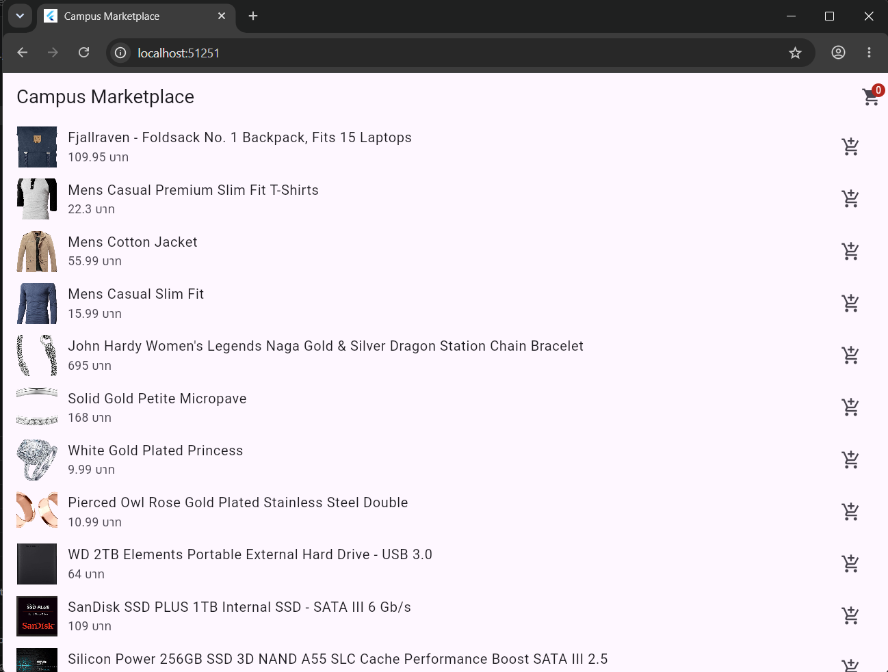

### หน้า Checkout ที่มีสินค้าในตะกร้า

แนบภาพหน้าจอ: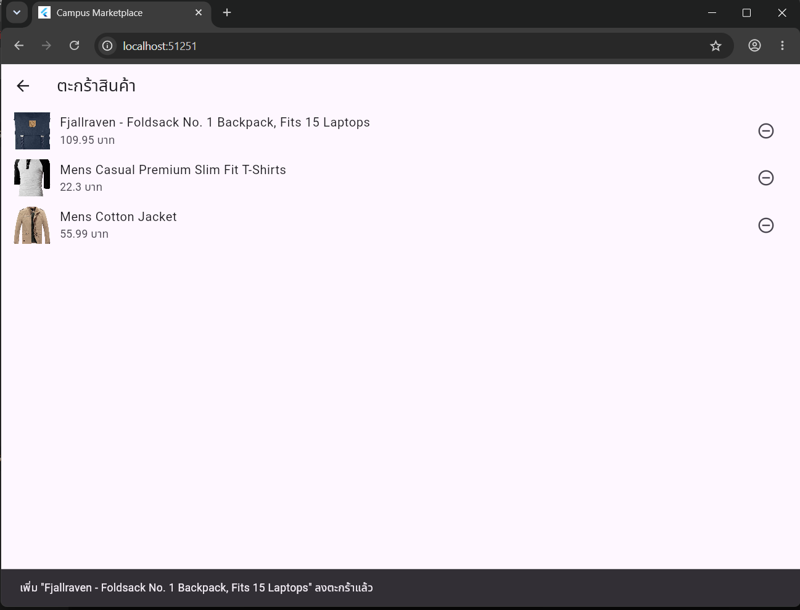

## Checkpoint 1.1: ทดลอง Prompt ใน Google AI Studio

แนบภาพหน้าจอจากการทดลอง Prompt และผลลัพธ์ JSON ทั้ง 3 ครั้ง:

1. ครั้งที่ 1:

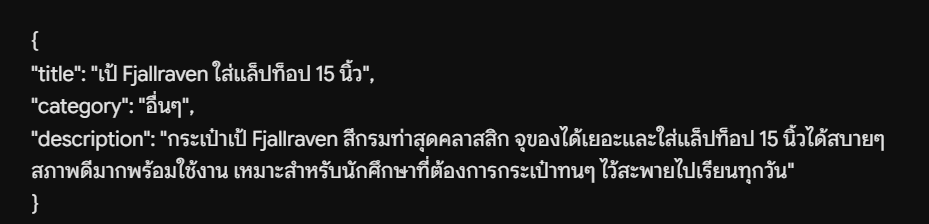

2. ครั้งที่ 2:

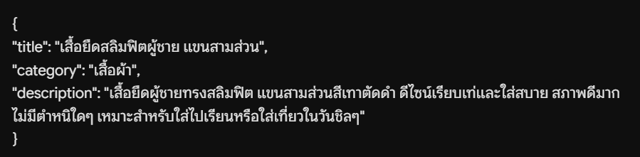

3. ครั้งที่ 3:

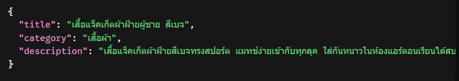

## Checkpoint 1.2: Structured Output

แนบภาพหน้าจอการตั้งค่า Structured Output และผลลัพธ์:

ความแตกต่างจากการทดลองใน Checkpoint 1.1:หาไม่เจอครับ!

[alt text](/image/image-5.png)

## Checkpoint 2.1: Text Generation

แนบภาพหน้าจอ Debug Console และ SnackBar ที่แสดงคำตอบจาก Gemini:

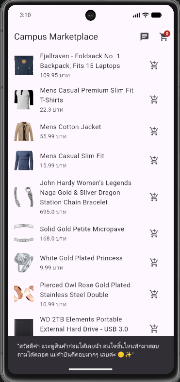

ความแตกต่างระหว่าง `.timeout()` 20 วินาทีของ Gemini API กับ 10 วินาทีของ OpenWeather API และเหตุผล:

OpenWeather API (10 วินาที): เป็นแค่การดึงข้อมูลที่มีอยู่แล้ว ทำงานเสร็จเร็ว ถ้ารอนานเกิน 10 วิแปลว่าเน็ตหลุดหรือเซิร์ฟเวอร์มีปัญหา จึงตัดจบไวเพื่อไม่ให้แอปค้างนาน

Gemini API (20 วินาที): เป็น AI ที่ต้องใช้เวลา "คิดประมวลผลและสร้างคำตอบใหม่" (ยิ่งวิเคราะห์รูปยิ่งนาน) จึงต้องเผื่อเวลาให้ AI ทำงานจนจบ ถ้าตั้งแค่ 10 วิ ระบบจะตัดการเชื่อมต่อก่อนที่ AI จะตอบเสร็จ

## Checkpoint 3.1: Bottom Navigation Bar

แนบภาพหน้าจอ Tab หน้าหลัก:

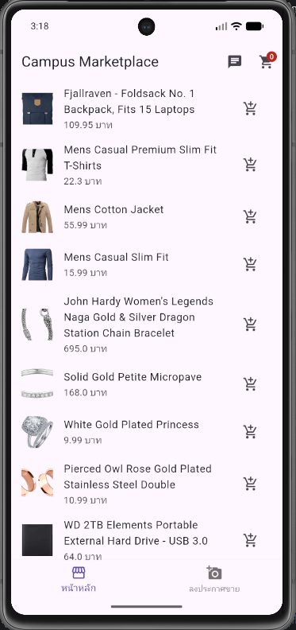

แนบภาพหน้าจอ Tab ลงประกาศขายที่เลือกรูปภาพแล้ว:

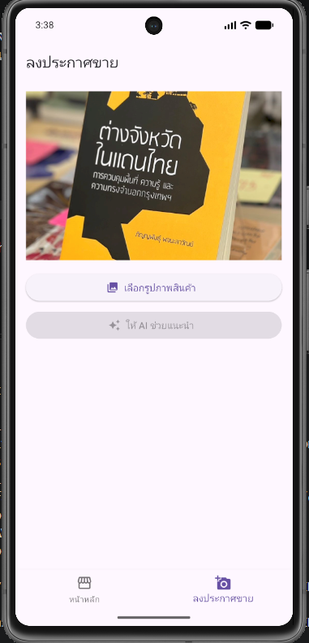

ผลการทดสอบสลับ Tab (รูปภาพยังอยู่หรือไม่) และการเปิดหน้า Checkout จากไอคอนตะกร้า:ยังอยู่

## Checkpoint 4.1: Gemini Vision

แนบภาพหน้าจอผลวิเคราะห์สินค้าอย่างน้อย 3 ภาพ:

1. ภาพสินค้าและผล `title` / `category` / `description`:

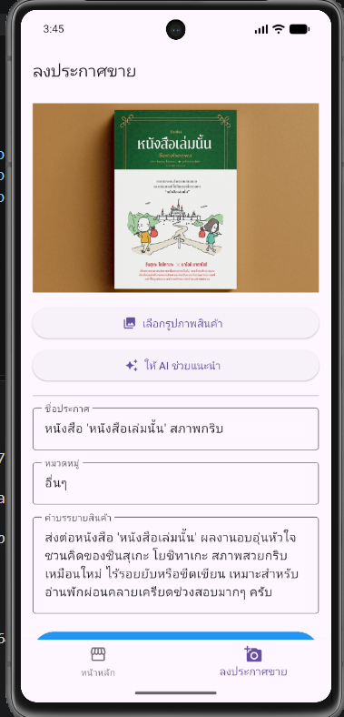

2. ภาพสินค้าและผล `title` / `category` / `description`:

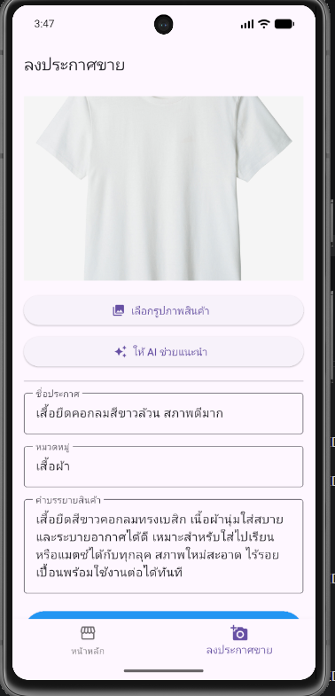

3. ภาพสินค้าและผล `title` / `category` / `description`:

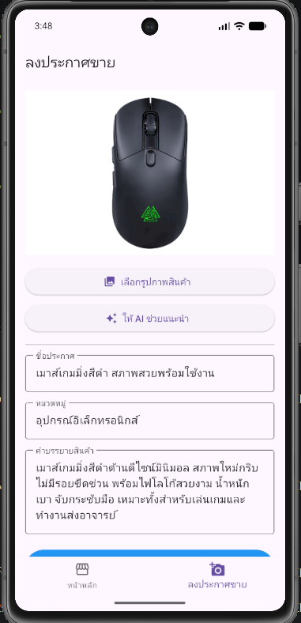

## Checkpoint 5.1: ตรวจทานและแก้ไขร่างประกาศ

แนบภาพหน้าจอค่าที่ AI แนะนำก่อนแก้ไข: 

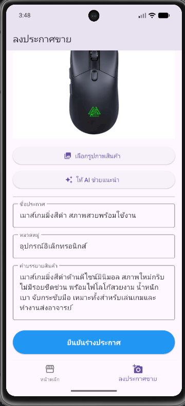

แนบภาพหน้าจอค่าหลังแก้ไขและยืนยันร่างประกาศ:

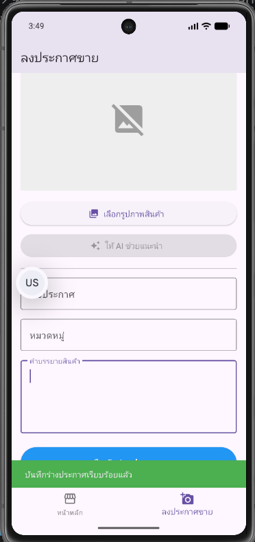

## Checkpoint 6.1: ทดสอบ AI Safety

แนบภาพหน้าจอ Error ที่แอปแสดงเมื่อ Gemini ปฏิเสธคำขอ:

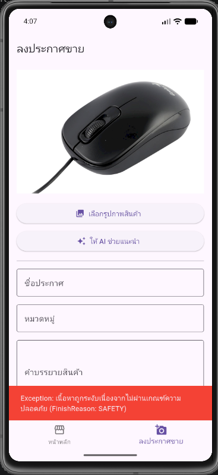

ผลการทดสอบ:

- ข้อความ Error ที่ได้รับ: เกิดข้อผิดพลาด: Exception: เนื้อหาถูกระงับเนื่องจากไม่ผ่านเกณฑ์ความปลอดภัย (FinishReason: SAFETY)
- เปลี่ยน `_prompt` กลับเป็น Prompt สำหรับวิเคราะห์สินค้าแล้ว: [ / ]
